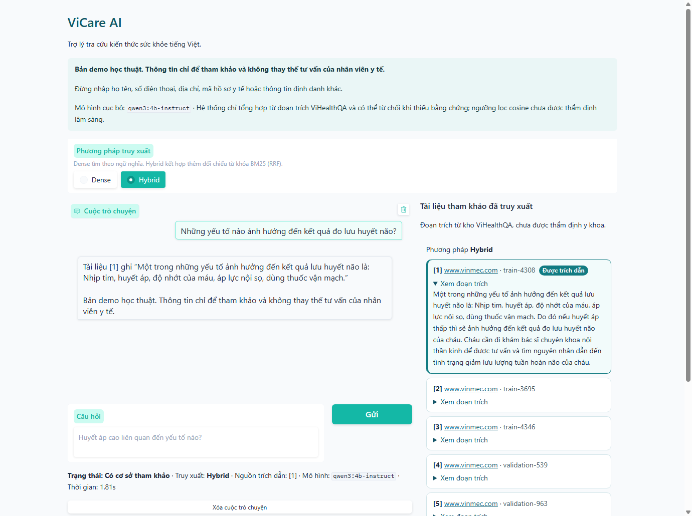

# ViCare AI

ViCare là demo tra cứu kiến thức sức khỏe tiếng Việt của Vương Đình Bình, phát triển từ bài thực hành `ViCare_Bootcamp24h.ipynb` của AI Challenge 24h. Người dùng nhập câu hỏi, chọn Dense hoặc Hybrid, rồi mở từng thẻ nguồn để kiểm tra câu trả lời. Ứng dụng chỉ lắng nghe trên máy cục bộ. Tài liệu ViHealthQA có thể đã cũ. Không nhập thông tin định danh hoặc dùng kết quả để chẩn đoán, kê đơn hay xử lý cấp cứu.

[Xem ảnh chạy thật](media/) · [Đánh giá và lệnh tái lập](results/submission/REPORT.md) · [Bài dự thi](SUBMISSION.md)

## Từ câu hỏi đến đoạn dẫn nguồn

Kho tra cứu gồm 9.895 tài liệu từ cột đáp án của ViHealthQA sau khi khử trùng, chia thành 11.227 đoạn, mỗi đoạn tối đa 200 từ và chồng lấn 40 từ. E5 mã hóa đoạn với tiền tố `passage:` và câu hỏi với `query:`. Chroma lưu vector chuẩn hóa 384 chiều. Câu hỏi và nhãn gold của bộ đánh giá không tham gia lập chỉ mục.

- **Dense** dùng tìm kiếm vector. **Hybrid** bổ sung BM25 ở cấp tài liệu, xử lý cụm hai từ và tìm kiếm bỏ dấu khi câu hỏi không có dấu. HNSW lấy 200 đoạn, sắp theo cosine rồi ID đoạn và giữ 80 đoạn. BM25 lấy 80 tài liệu. Sau khử trùng theo document ID, RRF hợp nhất hai thứ hạng với k=40 và trọng số 0,5 mỗi nhánh.
- Các nhánh cấp cứu và yêu cầu liều dùng cá nhân trả về sớm. Với câu hỏi còn lại, cổng truy xuất dùng cosine Dense tối thiểu 0,86. Đây là ngưỡng minh họa chưa được hiệu chỉnh lâm sàng.
- Ollama kiểm tra liệu nguồn có trả lời **đúng đối tượng, bệnh cảnh và mối quan hệ được hỏi**. ViCare chọn một câu nguyên văn trong nguồn được duyệt, đối chiếu phạm vi và kiểm tra số trích dẫn trước khi hiển thị. Nếu không đủ bằng chứng, ViCare có thể từ chối. Khi Ollama lỗi sau truy xuất, người dùng vẫn đọc được các đoạn đã tìm thấy.

## Cài lần đầu trên Windows

Cần Git, Python 3.11, Ollama và dung lượng trống cho model, cache Hugging Face và chỉ mục. Các phép đo sử dụng E5 trên CPU, RTX 4060 Laptop 8 GB cho Ollama và máy có khoảng 16 GB RAM. Đóng các bản ViCare không còn dùng trước khi chạy đánh giá để dành bộ nhớ cho chỉ mục.

```powershell
git clone https://github.com/Vdbinh05/ViCare-AI-Challenge.git
cd ViCare-AI-Challenge
py -3.11 -m venv .venv
.\.venv\Scripts\python.exe -m pip install -r requirements.txt
```

Nếu máy mới chưa có model, cài Ollama, mở ứng dụng Ollama và dùng `ollama pull qwen3:4b-instruct` một lần. Trên máy đã có đúng model, dùng lại kho hiện tại. Từ thư mục dự án, tạo chỉ mục một lần bằng lệnh dưới. Lần đầu cần mạng để lấy ViHealthQA và E5 tại revision đã ghim.

```powershell
$env:HF_HOME = Join-Path $PWD '.cache\hf'
.\.venv\Scripts\python.exe -m src.retrieval build
```

## Mở ứng dụng

Trong thư mục clone đã chuẩn bị, chỉ cần chạy:

```powershell
.\.venv\Scripts\python.exe app.py
```

Trên máy dự thi, có thể mở PowerShell ở **bất kỳ thư mục nào** và dùng:

```powershell
& 'D:\TT24H\ViCare-AI-Challenge\.venv\Scripts\python.exe' 'D:\TT24H\ViCare-AI-Challenge\app.py'
```

Mở URL in cạnh PID của phiên mới. ViCare chọn một cổng loopback trong khoảng 7860–7869. Có thể dùng `--port` để yêu cầu một cổng cụ thể. Máy chủ Ollama mặc định ở `http://127.0.0.1:11434`. Ứng dụng kiểm đúng tên model và thực hiện một lượt sinh ngắn. Nếu chưa có daemon, ViCare có thể chạy Ollama đã cài với kho model có sẵn.

| Khi gặp vấn đề | Cách kiểm tra |
|---|---|
| Thiếu chỉ mục hoặc sai phiên bản | Chạy lệnh build ở trên. Nếu dùng chỉ mục riêng, đặt `VICARE_INDEX_DIR`. |
| Không tìm thấy Ollama hoặc model | Kiểm tra `ollama list` trên đúng máy chủ. Đặt `VICARE_OLLAMA_EXE` và `VICARE_OLLAMA_MODELS` khi vị trí cài khác mặc định. Kho `D:\ollama_models` là bố trí máy dự thi. Máy chủ đã chạy dùng kho mà nó nhận lúc khởi động. |
| Câu trả lời báo lỗi dịch vụ | Xem chẩn đoán endpoint, HTTP hoặc timeout ở terminal. Sau khi dịch vụ hoạt động lại, gửi lại câu hỏi trong cùng giao diện. |
| Không mở được phiên mới | Đọc traceback và URL/PID thực tế. Cổng chỉ định bằng `--port` phải trống. Khi Windows báo lỗi nạp DLL hoặc paging file, kiểm tra bộ nhớ còn trống và các phiên Python đang nạp model. |

[Danh mục biến cấu hình](.env.example). Các biến tùy chọn được đọc từ môi trường của tiến trình. Tệp `.env.example` là tài liệu tham khảo.

## Thử trên giao diện

| Câu hỏi tổng hợp | Kết quả cần đối chiếu trên màn hình |
|---|---|
| Những yếu tố nào ảnh hưởng đến kết quả đo lưu huyết não? | Mở nguồn `train-4308` để kiểm tra nguyên câu nói về các yếu tố ảnh hưởng **phép đo**. |
| Thủ đô của nước Úc là gì? | Từ chối với lý do ngoài phạm vi sức khỏe. |
| Thuốc giả định ZYX-9000 có chữa khỏi mọi bệnh mạn tính không? | Từ chối do thiếu bằng chứng. |

## Kết quả trên bộ dev

| Truy xuất trên cùng 100 câu | Recall@1 | Recall@3 | Recall@5 | Recall@10 | Gold có trong chỉ mục |
|---|---:|---:|---:|---:|---:|
| Dense | 37% | 47% | 51% | 55% | 100% |
| Hybrid bản nộp | 38% | 52% | 55% | 60% | 100% |

Ở top 5, Hybrid tìm thêm tài liệu chuẩn ở 6 câu và mất ở 2 câu. Trên 10 câu đầu chạy toàn bộ ứng dụng, có 1 câu được trả lời với trích dẫn, 8 câu bị từ chối và 1 câu chuyển sang hướng dẫn cấp cứu. Judge của notebook chạy bằng Qwen cho 9/10, gồm cả 7 lượt từ chối được chấm 1. Có 0 điểm judge không hợp lệ và 0 lỗi kỹ thuật. Dev100 đã được dùng phân tích lỗi. [Bảng từng câu và giới hạn của phép chấm](results/submission/generation-review.md)

Sau khi tạo chỉ mục và chuẩn bị Ollama, chạy từ thư mục dự án:

~~~powershell
.\.venv\Scripts\python.exe -X utf8 -m src.evaluation --output .private/retrieval-rerun
.\.venv\Scripts\python.exe -X utf8 -m benchmarks.evaluate_generation
~~~

Lệnh thứ hai ghi lại kết quả lần chạy vào `results/submission/generation.json` và bản đầy đủ chứa văn bản ViHealthQA vào `.private/generation/dev10.json`. Xem lệnh kiểm thử và các điều kiện đo trong [báo cáo](results/submission/REPORT.md).



## Nguồn và điều kiện sử dụng

- Thiết kế kho và bộ dev xuất phát từ notebook thực hành của BTC. Mã ứng dụng, kiểm thử và hồ sơ nộp có sử dụng công cụ hỗ trợ lập trình AI. Việc đối chiếu từng câu được ghi rõ trong báo cáo.
- ViHealthQA do Nhung Thi-Hong Nguyen và cộng sự giới thiệu trong *SPBERTQA: A Two-Stage Question Answering System Based on Sentence Transformers for Medical Texts* (KSEM 2022). Tác giả ghi dữ liệu dành cho nghiên cứu và cảnh báo có thể chứa thông tin cá nhân. Repo chỉ phân phối mã tải và xử lý cùng kết quả đã rút gọn. [Dataset card](https://huggingface.co/datasets/tarudesu/ViHealthQA) · [Bài báo](https://arxiv.org/abs/2206.09600)
- Embedding dùng `intfloat/multilingual-e5-small` (MIT). Mô hình sinh là `qwen3:4b-instruct` trong Ollama (Apache-2.0). Trọng số và thư viện phụ thuộc giữ điều kiện sử dụng của nhà phát hành. [E5](https://huggingface.co/intfloat/multilingual-e5-small) · [Qwen trên Ollama](https://ollama.com/library/qwen3:4b-instruct) · [Phiên bản thư viện](requirements.txt)
